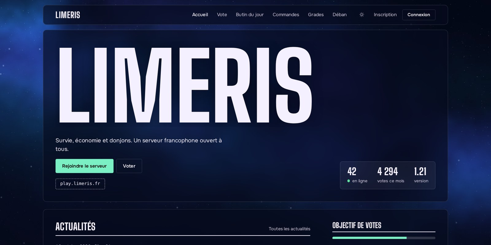
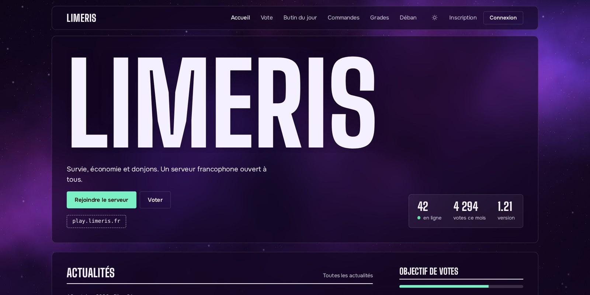
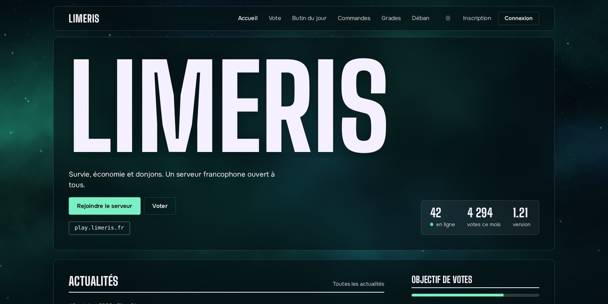
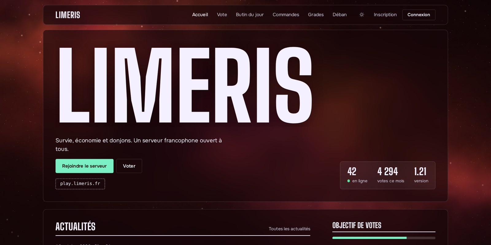
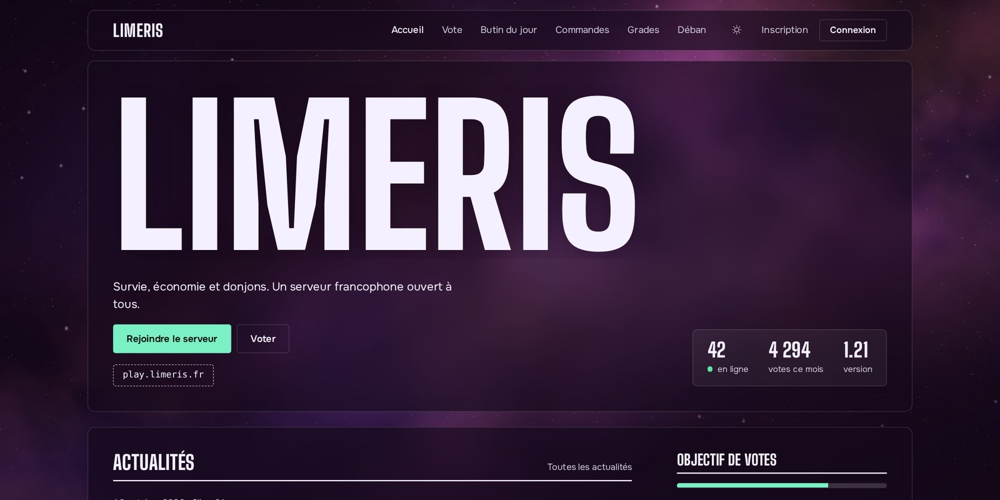
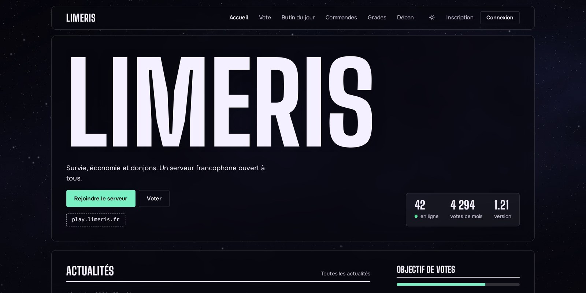
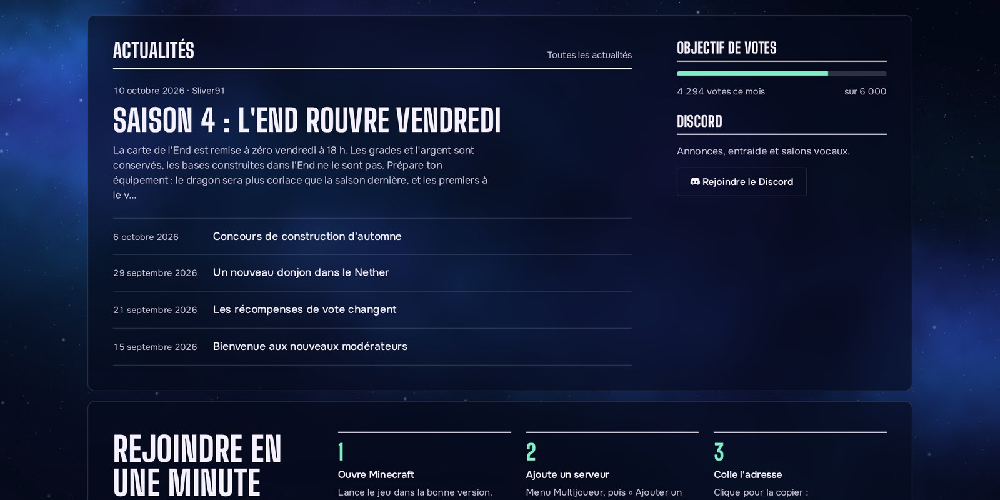
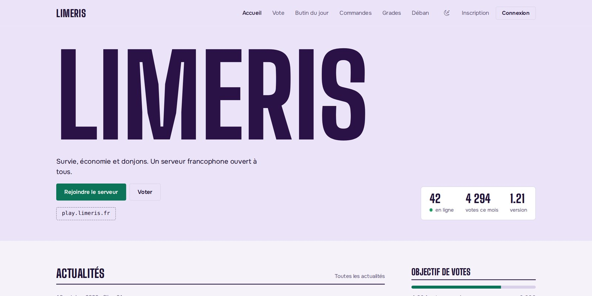
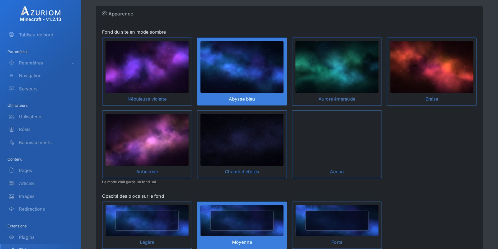

# Nebula Limeris

**Limeris.fr by Sliver91** · [Discord](https://discord.gg/4kV8pgC3Ck) · [limeris.fr](https://limeris.fr)

A theme for the [Azuriom](https://azuriom.com) CMS. Your server name is displayed in huge letters, the site sits on a space background of your choice, and every area is a translucent block on top of it.

[Lire en français](README.fr.md)

<!-- gallery -->
## Preview

### Six space backgrounds

| | |
|:-:|:-:|
|  **Blue abyss** |  **Purple nebula** |
|  **Emerald aurora** |  **Ember** |
|  **Pink dawn** |  **Star field** |

### News, vote goal and Discord

### Light mode

### Settings with illustrated cards

Screenshots use demo content (in French).
<!-- /gallery -->

## What players see

- A navigation bar, then the server name in large type with a tagline, a button to join the server (it copies the address) and a button to vote.
- Three figures: online players, votes this month, game version.
- News, vote goal, top voters of the month, server list and a Discord block.
- A three-step "Join in one minute" reminder.
- Light and dark mode. Space backgrounds are shown in dark mode.
- Azuriom and plugin pages (vote, shop, login…) use the same colors and blocks.
- Works with every game supported by Azuriom.

## Requirements

- Azuriom 1.2 or newer.
- The **Vote** plugin is optional: without it, the "Vote" button, the goal and the ranking are hidden.
- No external dependency: fonts, images and scripts ship with the theme.
- Built on Bootstrap 5 and Bootstrap Icons, both included in Azuriom. No jQuery.

## Installation

**From the Azuriom Market**: in the admin panel, open **Themes**, find Nebula Limeris and click **Install**.

**Manually**:

1. Create the `resources/themes/nebula-limeris` folder on your Azuriom site.
2. Extract the zip into it: `theme.json` must sit directly in that folder.
3. In the admin panel, open **Themes** and click **Enable** next to Nebula Limeris.

Then click **Configure** to set up the theme. For the "online" figure and the address to show up, add your server in **Servers** and select it as the default server.

## Configuration

Everything is set in **Themes > Nebula Limeris > Configure**.

### Appearance
- **Site background**: Blue abyss, Purple nebula, Emerald aurora, Ember, Pink dawn, Star field, or none.
- **Block opacity**: light, medium or strong.
- **Shape**: square, slightly rounded or very rounded.
- **Heading font**: condensed, wide or technical.
- **Accent colors**: one for dark mode, one for light mode.
- **Dark mode by default** for new visitors.

### Navigation
- Show the site logo next to the name.
- Keep the menu visible while scrolling.
- Let visitors switch between light and dark, or not.

### Top of the home page
- Big title (empty: the site name), title size, tagline.
- Server address (only used when no default server is selected) and game version.
- "Vote" button, one free extra button, displayed figures.

### Home page sections
- News, vote goal, top voters (3, 5 or 10), server list, "Join in one minute".
- Discord invite link (empty: the block is hidden).

### Footer
- About text, Azuriom social links, custom links.

## Updating

Replace the `resources/themes/nebula-limeris` folder with the new version. Azuriom keeps your settings.

## Uninstalling

Enable another theme in **Themes**, then delete Nebula Limeris from the same page.

## Support

A question or an issue: [Discord](https://discord.gg/4kV8pgC3Ck).

## Credits

The bundled fonts are licensed under the SIL Open Font License 1.1, see `assets/fonts/CREDITS.md`. The space backgrounds were made for this theme.

---

**Limeris.fr by Sliver91** · [Discord](https://discord.gg/4kV8pgC3Ck)
